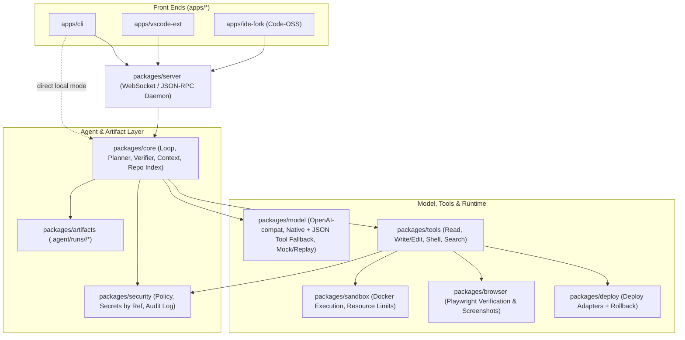
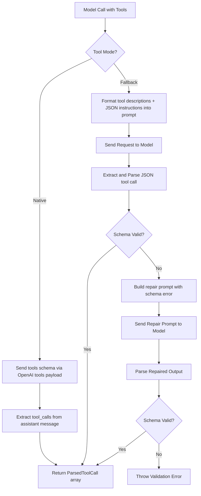
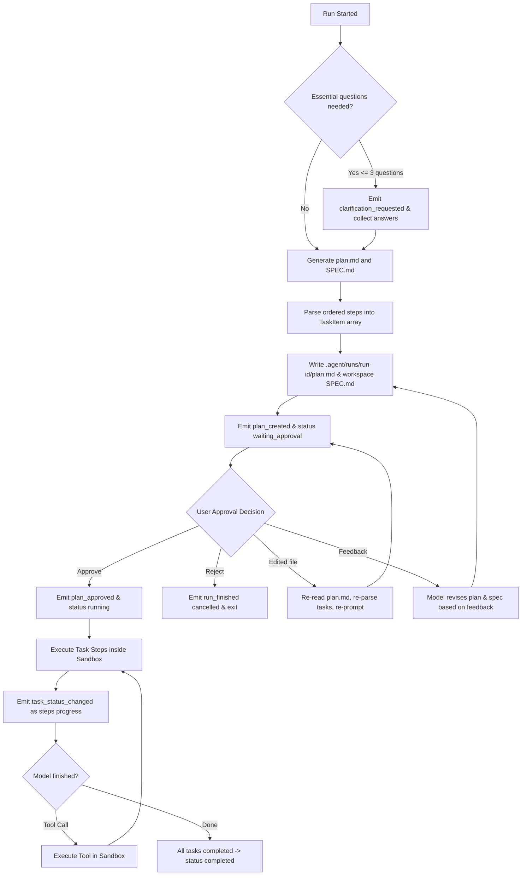
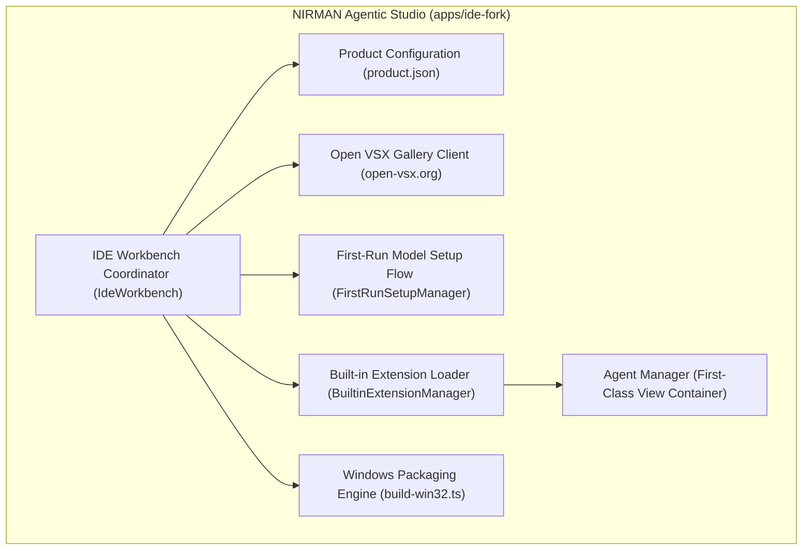

# NIRMAN Architecture

NIRMAN is an agentic coding IDE in the style of Google Antigravity, built on a strict TypeScript (`Node >= 20`) `pnpm` monorepo. Every front end (CLI, VS Code extension, and later the Code-OSS fork) talks to the same core engine and reads the same plain-file artifacts under `.agent/runs/<run-id>/`.

## System Overview



## Package Responsibilities

### `packages/*`

| Package              | Responsibility                                                                                                                                                                                     |
| -------------------- | -------------------------------------------------------------------------------------------------------------------------------------------------------------------------------------------------- |
| `packages/model`     | Single OpenAI-compatible client with streaming, native tool-call parsing, structured-JSON-in-text fallback for models without native tool calling, and deterministic mock/replay mode for testing. |
| `packages/tools`     | Tool registry and implementations for workspace `read`, `write`/`edit`, `shell`, `search`, and later browser/deploy tools, with strict output truncation for small-context models.                 |
| `packages/sandbox`   | Docker-based isolated command execution with CPU/memory/time limits and no host filesystem or network access by default.                                                                           |
| `packages/artifacts` | Plain-file persistence under `.agent/runs/<run-id>/` (`plan.md`, `tasks.json`, `diff.patch`, `log.txt`, `screenshots/`). Single source of truth shared by all front ends.                          |
| `packages/core`      | Agent loop with hard limits (steps, retries, wall-clock, output size), planner, verifier, small-context manager (32k–64k token budget), and deterministic repo index.                              |
| `packages/security`  | Permission/approval policy (plan first, approve destructive/external actions), secret references (never exposed to model context), and append-only audit log.                                      |
| `packages/browser`   | Playwright-based live app verification, console/network checks, and screenshot capture attached to run artifacts.                                                                                  |
| `packages/deploy`    | Deployment adapter interface and implementations (e.g., Docker/SSH self-host and one PaaS) with explicit approval and rollback.                                                                    |
| `packages/server`    | Local daemon exposing the agent runtime and run/artifact state over WebSocket / JSON-RPC event streams.                                                                                            |
| `evals`              | Automated evaluation harness with 20 project-description tasks, multi-model benchmarking, failure diagnostics, and comparative markdown/JSON reporting.                                            |

### `apps/*`

| App               | Responsibility                                                                                                     |
| ----------------- | ------------------------------------------------------------------------------------------------------------------ |
| `apps/cli`        | Command-line front end for running, approving, and inspecting agent runs.                                          |
| `apps/vscode-ext` | Early-stage VS Code extension providing chat, plan/artifact viewer, diff review, and multi-agent Agent Manager UI. |
| `apps/ide-fork`   | Late-stage Code-OSS (MIT) fork with Open VSX, custom NIRMAN branding, and built-in agent experience.               |

## Model Architecture (`packages/model`)

The model package provides a clean, single abstraction (`ModelClient`) for communicating with any OpenAI-compatible server (llama.cpp, Ollama, vLLM, OpenAI).

### Key Interfaces

- **`ModelClient`**: Exposes `chat()`, `streamChat()`, and `chatWithTools()`.
- **`ModelConfig`**: Configurable `baseUrl`, `model`, `toolMode` (`'native' | 'fallback'`), `temperature`, `timeoutMs`, and `contextWindowLimit`.
- **`ParsedToolCall`**: Normalized representation of tool calls across both native and fallback modes: `{ id, name, arguments }`.
- **`ContextWindowAnalysis`**: Tracks token budget (`usedTokens`, `remainingTokens`, `percentUsed`, `isNearLimit`, `isExceeded`).

### Native vs. Fallback Tool Calling Flow



## Sandbox Architecture (`packages/sandbox`)

All file access and shell execution are strictly mediated by the `Sandbox` interface:

- **Path Confinement:** `resolveSafePath` ensures every path is strictly contained within `workspaceRoot`. Directory escape attempts (`../`, `/etc/passwd`, absolute external drives) throw `PathEscapeError`.
- **Resource & Process Limits:** Commands run with CPU, memory, and timeout limits. When a timeout occurs, the process tree is immediately killed (`taskkill` on Windows / `SIGKILL` on Unix) and returns `timedOut: true` with exit code 124.
- **Network Isolation:** Defaults to `--network none`. Package installs or external operations require explicit network opt-in (`allowNetwork: true`).
- **Implementations:**
  - `DockerSandbox`: Mounts the workspace to `/workspace:rw` inside a container (`node:20-bookworm-slim` by default) with CPU/memory limits and isolated networking.
  - `LocalSandbox`: Fast host-isolated sandbox enforcing identical path boundary checks and process timeout kills.

## Tools Architecture (`packages/tools`)

Every tool exports an OpenAI-compatible JSON Schema definition, provides input validation via `@nirman/model`'s `validateSchema`, and enforces strict output truncation (`DEFAULT_MAX_OUTPUT_BYTES = 16_384`) with explicit truncation notices.

| Tool         | Parameters                                                                     | Security & Constraints                                                                      |
| ------------ | ------------------------------------------------------------------------------ | ------------------------------------------------------------------------------------------- |
| `read_file`  | `path: string`, `startLine?: number`, `endLine?: number`                       | Confined to workspace; optional 1-indexed line range; output truncated if over limit.       |
| `write_file` | `path: string`, `content: string`, `overwrite?: boolean`                       | Automatically creates parent directories; rejects overwriting if `overwrite: false`.        |
| `edit_file`  | `path: string`, `target: string`, `replacement: string`                        | Exact string replacement; **fails if target is not found or ambiguous** (>1 occurrence).    |
| `list_dir`   | `path?: string`, `recursive?: boolean`, `maxEntries?: number`                  | Lists entries sorting directories first; truncated if entry count exceeds budget.           |
| `search`     | `query: string`, `path?: string`, `regex?: boolean`, `caseSensitive?: boolean` | Ripgrep-style search; ignores noise directories (`node_modules`, `.git`, `dist`, `.agent`). |
| `run_shell`  | `command: string`, `timeoutMs?: number`, `allowNetwork?: boolean`              | Executes inside Sandbox; shell timeouts kill the process; network off by default.           |

## Artifacts & Event Stream (`packages/artifacts`)

Every run creates a folder under `.agent/runs/<run-id>/` containing:

- `log.txt`: Append-only, chronological text log of every event.
- `tasks.json`: Current run metadata, step counts, run status (`planning`, `waiting_approval`, `running`, `completed`, `failed`, `cancelled`), and ordered tasks breakdown.
- `plan.md`: The approved execution plan (stack, folder structure, ordered steps, test strategy).
- Workspace `SPEC.md`: Technical specification in workspace root (stack, conventions, commands to build/test/run).

### Typed Event Stream

All front ends (CLI, WebSocket daemon, VS Code extension) consume the same strongly-typed event stream:

- `run_started`: Emitted when run starts with task description.
- `clarification_requested`: Emitted when model requires up to 3 essential clarifying questions.
- `plan_created`: Emitted when `plan.md` and `SPEC.md` are generated or updated with ordered tasks.
- `plan_revision_requested`: Emitted when user provides feedback requesting plan revision.
- `plan_approved`: Emitted when user explicitly approves the plan.
- `task_status_changed`: Emitted when an individual task transitions status (`pending` -> `in_progress` -> `completed` / `failed`).
- `model_message`: Emitted when model produces textual thoughts or replies.
- `tool_call`: Emitted when model calls a tool with arguments.
- `tool_result`: Emitted when a tool finishes execution with output/error.
- `run_finished`: Emitted when execution concludes with status and step count.
- `error`: Emitted on fatal error or unhandled exception.

## Planning & Agent Loop Architecture (`packages/core`)

The agent lifecycle in `runAgentLoop` operates in two distinct, sequential phases:



1. **Planning Phase (Plan First, Act Second):**
   - **Clarifications:** `Planner.generateClarifications` asks at most 3 questions only if essential.
   - **Plan & Spec Generation:** `Planner.generatePlan` generates `plan.md` (stack, folder structure, ordered steps with `### Step <n>: <title>`, test strategy) and `SPEC.md` (overview, conventions, commands to build/test/run).
   - **Approval Gate:** Execution **never** starts before explicit approval. The user can:
     - **Approve:** Proceeds to execution.
     - **Edit `plan.md` directly:** The agent re-reads the updated file, re-parses tasks, and updates `tasks.json`.
     - **Reply with comments:** `Planner.revisePlan` updates `plan.md` and `SPEC.md` based on feedback.
     - **Reject:** Run is cleanly cancelled with reason.
2. **Execution & Verification Phase:**
   - **Focused Small-Context:** For each task, the model prompt is constructed strictly from `SPEC.md`, completed prior tasks summary, current workspace file list, and the single task description. File dumping into context is avoided.
   - **Deterministic Verification:** Build and test commands are extracted from `SPEC.md` and task descriptions (`extractVerificationCommands`) and executed deterministically via `runVerification`.
   - **Targeted Error Feedback:** On failure, `parseRelevantError` isolates compiler errors, test assertions, and stack traces, capped to a strict 2048-byte context budget.
   - **Capped Fix Loop:** Each task has a retry limit (`maxRetriesPerTask`, default 3). If verification fails repeatedly, the task is marked `blocked` with an explicit reason rather than looping indefinitely.
   - **Git Diff Tracking:** Every completed task captures a unified git patch at `.agent/runs/<run-id>/tasks/<task-id>/diff.patch`, and the overall run captures a cumulative `diff.patch`.
   - **Walkthrough Report:** A final `walkthrough.md` is generated detailing what was built, how to run and test it, an execution table with task statuses, and failure/blocker summaries.

## Context Manager & Repo Index (`packages/core`)

For small context windows (32k–64k total, or 4k–8k per prompt), NIRMAN includes an embedded repository index and context manager:

### 1. Embedded Repository Index (`RepoIndex`)
- **Persistence:** Local SQLite database via Node's native `node:sqlite` (`DatabaseSync`), requiring zero external native compilation or external database daemons.
- **Symbol Extraction:** Uses `web-tree-sitter` and precompiled WASM grammars (`tree-sitter-wasms`) for TypeScript/TSX, JavaScript, and Python (with regex fallback for other languages). Extracts classes, functions, methods, and interfaces with start/end line coordinates.
- **File Summaries:** Automatically generates concise summaries per file containing exports, top-level symbol signatures, and line counts.
- **Fast Deterministic Embeddings:** 256-dimensional subword character n-gram and token feature hashing with L2 unit normalization. Serialized as `Float32Array` BLOBs directly into SQLite.
- **Hybrid Retrieval:** Multi-stage retrieval combining:
  1. Cosine similarity of task embeddings against file/snippet vectors.
  2. Exact keyword / token frequency matching.
  3. Symbol definition match bonus.
  Results are sorted by relevance and packed into top snippets strictly within a configured token budget.

### 2. Context Manager (`ContextManager`)
- **Turn Assembly:** Assembles model calls dynamically:
  1. Base system prompt.
  2. Workspace `SPEC.md` (project conventions, build/test commands).
  3. Current task title, description, and status.
  4. Top retrieved snippets from `RepoIndex`.
  5. Rolling summary of older conversation turns compressed when turns exceed `maxRecentTurns`.
  6. Recent conversational turns packed backwards (newest first).
- **Hard Token Budget Enforcement:** Strictly guarantees that assembled messages do not exceed `tokenBudget - reserveCompletionTokens`. Automatically sheds lower-priority snippets or oldest turns if the budget is pressured.
- **Audit Logging:** Every assembly outputs structured `ContextAssemblyStats` logging exact token breakdown (`systemPromptTokens`, `specTokens`, `taskTokens`, `snippetsTokens`, `turnsTokens`, `rollingSummaryTokens`) and an array of `dropped` items.

## Browser Automation & Live Verification (`packages/browser`)

NIRMAN integrates headless browser automation powered by Playwright (`playwright-core` with native Edge/Chromium support) to verify web applications and capture visual proof of working user flows:

### 1. Dev Server Manager (`DevServerManager`)
- **Extraction:** Automatically extracts server run commands and port/URL configurations from workspace `SPEC.md` or task descriptions (`Dev Server: ...`, `URL: ...`).
- **Readiness Polling:** Spawns the server child process and actively polls the endpoint via HTTP until the server responds with a 2xx/3xx status code.
- **Process Lifecycle:** Cleanly stops and kills the entire process tree on completion or test failure using `taskkill` on Windows or `SIGKILL` on Unix to prevent zombie server processes or port collisions.

### 2. Browser Driver (`BrowserDriver`)
- **Engine:** Playwright-based browser driver supporting system Microsoft Edge (`msedge` channel on Windows) and Chromium in headless mode without extra browser downloads.
- **Diagnostics:** Automatically captures and indexes:
  - Browser console errors and warnings (`page.on('console')`).
  - Failed network requests and HTTP 4xx/5xx responses (`page.on('requestfailed')`, `page.on('response')`).
- **Compact DOM Extraction (`extractDomSummary`):** Extracts page title, headings (`h1`..`h6`), interactive elements (`button`, `input`, `select`, `textarea`, `a[href]`) with clean CSS selectors, and visible text content. Formats a token-efficient summary designed to fit strictly within small LLM context limits (< 1,500 tokens).

### 3. Automated Browser Verification Phase (`BrowserVerifier`)
- **Checklist Derivation:** Derives a multi-step user behavior checklist from `plan.md` and `SPEC.md` covering key interactions (e.g. initial render, text typing, button submission, state toggling).
- **Execution & Visual Proof:** Drives the browser through each checklist item, asserting expected elements and text, and capturing timestamped PNG screenshots (`1-initial-render.png`, `2-item-added.png`, etc.) saved to `.agent/runs/<run-id>/screenshots/`.
- **Artifacts & Fix Loop Routing:** Produces `browser-verification.md` and `browser-verification.json` in run artifacts. On failure, captures a failure screenshot and returns structured error diagnostics (console errors, failed requests, DOM mismatch) back into the retry/fix loop.

## Context Manager & Repo Index (`packages/core`)

For small context windows (32k–64k total, or 4k–8k per prompt), NIRMAN includes an embedded repository index and context manager:

### 1. Embedded Repository Index (`RepoIndex`)
- **Persistence:** Local SQLite database via Node's native `node:sqlite` (`DatabaseSync`), requiring zero external native compilation or external database daemons.
- **Symbol Extraction:** Uses `web-tree-sitter` and precompiled WASM grammars (`tree-sitter-wasms`) for TypeScript/TSX, JavaScript, and Python (with regex fallback for other languages). Extracts classes, functions, methods, and interfaces with start/end line coordinates.
- **File Summaries:** Automatically generates concise summaries per file containing exports, top-level symbol signatures, and line counts.
- **Fast Deterministic Embeddings:** 256-dimensional subword character n-gram and token feature hashing with L2 unit normalization. Serialized as `Float32Array` BLOBs directly into SQLite.
- **Hybrid Retrieval:** Multi-stage retrieval combining:
  1. Cosine similarity of task embeddings against file/snippet vectors.
  2. Exact keyword / token frequency matching.
  3. Symbol definition match bonus.
  Results are sorted by relevance and packed into top snippets strictly within a configured token budget.

### 2. Context Manager (`ContextManager`)
- **Turn Assembly:** Assembles model calls dynamically:
  1. Base system prompt.
  2. Workspace `SPEC.md` (project conventions, build/test commands).
  3. Current task title, description, and status.
  4. Top retrieved snippets from `RepoIndex`.
  5. Rolling summary of older conversation turns compressed when turns exceed `maxRecentTurns`.
  6. Recent conversational turns packed backwards (newest first).
- **Hard Token Budget Enforcement:** Strictly guarantees that assembled messages do not exceed `tokenBudget - reserveCompletionTokens`. Automatically sheds lower-priority snippets or oldest turns if the budget is pressured.
- **Audit Logging:** Every assembly outputs structured `ContextAssemblyStats` logging exact token breakdown (`systemPromptTokens`, `specTokens`, `taskTokens`, `snippetsTokens`, `turnsTokens`, `rollingSummaryTokens`) and an array of `dropped` items.

## Browser Automation & Live Verification (`packages/browser`)

NIRMAN integrates headless browser automation powered by Playwright (`playwright-core` with native Edge/Chromium support) to verify web applications and capture visual proof of working user flows:

### 1. Dev Server Manager (`DevServerManager`)
- **Extraction:** Automatically extracts server run commands and port/URL configurations from workspace `SPEC.md` or task descriptions (`Dev Server: ...`, `URL: ...`).
- **Readiness Polling:** Spawns the server child process and actively polls the endpoint via HTTP until the server responds with a 2xx/3xx status code.
- **Process Lifecycle:** Cleanly stops and kills the entire process tree on completion or test failure using `taskkill` on Windows or `SIGKILL` on Unix to prevent zombie server processes or port collisions.

### 2. Browser Driver (`BrowserDriver`)
- **Engine:** Playwright-based browser driver supporting system Microsoft Edge (`msedge` channel on Windows) and Chromium in headless mode without extra browser downloads.
- **Diagnostics:** Automatically captures and indexes:
  - Browser console errors and warnings (`page.on('console')`).
  - Failed network requests and HTTP 4xx/5xx responses (`page.on('requestfailed')`, `page.on('response')`).
- **Compact DOM Extraction (`extractDomSummary`):** Extracts page title, headings (`h1`..`h6`), interactive elements (`button`, `input`, `select`, `textarea`, `a[href]`) with clean CSS selectors, and visible text content. Formats a token-efficient summary designed to fit strictly within small LLM context limits (< 1,500 tokens).

### 3. Automated Browser Verification Phase (`BrowserVerifier`)
- **Checklist Derivation:** Derives a multi-step user behavior checklist from `plan.md` and `SPEC.md` covering key interactions (e.g. initial render, text typing, button submission, state toggling).
- **Execution & Visual Proof:** Drives the browser through each checklist item, asserting expected elements and text, and capturing timestamped PNG screenshots (`1-initial-render.png`, `2-item-added.png`, etc.) saved to `.agent/runs/<run-id>/screenshots/`.
- **Artifacts & Fix Loop Routing:** Produces `browser-verification.md` and `browser-verification.json` in run artifacts. On failure, captures a failure screenshot and returns structured error diagnostics (console errors, failed requests, DOM mismatch) back into the retry/fix loop.

## Deployment Architecture (`packages/deploy`)

The deployment package (`packages/deploy`) implements a pluggable, multi-target deployment system supporting self-hosted servers and PaaS providers (Render) with strict approval gates, secret reference resolution, live browser verification, rollback retention, and tamper-evident audit logging.

### 1. Adapter Interface (`IDeployAdapter`)
Every deployment target implements a common interface:
- `detect(project: ProjectContext): Promise<DetectionResult>`: Inspects workspace files (`package.json`, `requirements.txt`, `index.html`, `Dockerfile`, `render.yaml`) and SPEC.md to determine project type, port, and deployment readiness.
- `build(project: ProjectContext): Promise<BuildResult>`: Prepares deployment artifacts and builds container images.
- `preview(project: ProjectContext, env: DeploymentEnvironment): Promise<DeployPreview>`: Generates an action checklist, target host, preview URL, and list of injected secret keys (values strictly hidden) for human review before execution.
- `deploy(project: ProjectContext, env: DeploymentEnvironment): Promise<DeployResult>`: Executes the deployment and returns `{ success, url, releaseId, timestamp, logs }`.
- `verify(url: string, screenshotsDir?: string): Promise<VerificationResult>`: Verifies live URL health via HTTP status checks and Playwright browser automation with screenshot capture.
- `rollback(releaseId: string): Promise<RollbackResult>`: Reverts active deployment to the previous release.
- `logs(releaseId: string): Promise<string[]>`: Retrieves build and runtime container logs for a release.

### 2. Supported Adapters
- **Self-Hosted Adapter (`SelfHostedAdapter`):**
  - **Dockerfile Generation:** Automatically generates a production Dockerfile if missing (customized for Node.js, static HTML sites with `serve`, Python, or generic binaries).
  - **SSH & Caddy with Automatic TLS:** Deploys container to server over SSH behind a Caddy reverse proxy with automatic TLS, compression (`gzip`, `zstd`), and security headers (`X-Content-Type-Options: nosniff`).
  - **Zero-Downtime Rollback:** Re-points Caddy reverse proxy to the previous release container port and reloads Caddy gracefully.
- **Render PaaS Adapter (`RenderAdapter`):**
  - **Blueprint Generation:** Generates `render.yaml` infrastructure-as-code if missing.
  - **Cloud Deploy:** Deploys web service to Render with environment-specific configurations and health check endpoints.
  - **Rollback:** Restores previous active release on Render.

### 3. Deployment Orchestration & Security Guarantees (`DeploymentOrchestrator`)
- **Mandatory Approval Gate:** Deploys **always** require explicit user approval. Orchestrator triggers `onApproval(preview)` with a detailed preview of all actions, URLs, and secret keys. Execution aborts immediately if approval is rejected.
- **Secrets Injected by Reference:** Secrets are defined as references (`{{secret:NAME}}`). Orchestrator resolves them directly from `EncryptedSecretsStore` before deployment; secret values are never included in preview payloads, event streams, or audit logs.
- **Post-Deploy Browser Verification:** Immediately following deployment, Playwright drives a headless browser to the live target URL, verifies page load/HTTP 200, checks page title, and saves visual proof screenshots to `.agent/runs/<run-id>/deploy/screenshots/`.
- **Release Retention & Rollback (`ReleaseManager`):** Tracks release history in `.agent/releases.json`. Keeps the last $N$ releases (default 5) for instant rollback.
- **Audit Logging:** Every deployment event (preview generation, user approval/rejection, build, deploy execution, verification, and rollback) is logged to the append-only, SHA-256 hash-chained `AuditLogger` with secret redaction.
- **Deployment Artifacts:** Produces `deployment-report.md`, `deployment.json`, and `rollback-report.md` in `.agent/runs/<run-id>/deploy/`.

## Local Daemon & JSON-RPC WebSocket Server (`packages/server`)

The server package (`packages/server`) provides a persistent local daemon exposing core Nirman agent capabilities over WebSocket + JSON-RPC 2.0 with per-session authentication, concurrent run isolation in git worktrees, and typed event streaming.

### 1. JSON-RPC 2.0 Protocol & Methods
The daemon exposes 11 RPC methods:
- `start_run`: Initiates an agent run in an isolated git worktree with dedicated artifacts and sandbox.
- `list_runs`: Returns records and status for all active and completed runs.
- `get_run`: Returns detailed state for a specific run including tasks, step count, and error state.
- `approve_plan`: Approves a generated plan in `waiting_approval` state, unblocking the execution phase.
- `comment`: Submits user feedback for plan revision.
- `pause`: Pauses active execution loop between turns or during planning.
- `resume`: Resumes paused execution loop.
- `cancel`: Terminates a running, paused, or planning run cleanly.
- `approve_action`: Approves or rejects a pending security policy action or risky tool call.
- `list_artifacts`: Lists all artifact files generated in `.agent/runs/<run-id>/` (reports, logs, patches, walkthroughs).
- `read_artifact`: Reads content of a specific artifact file safely without directory escape.

### 2. Typed Event Streaming
Whenever an agent event occurs (`run_started`, `model_message`, `tool_call`, `tool_result`, `plan_created`, `task_status_changed`, `verification_started`, `verification_finished`, `task_retry`, `walkthrough_created`, `run_finished`, `error`), the daemon broadcasts a JSON-RPC 2.0 notification to connected authenticated clients:
```json
{
  "jsonrpc": "2.0",
  "method": "agent_event",
  "params": {
    "runId": "run-12345",
    "event": { ... }
  }
}
```

### 3. Concurrent Git Worktree Isolation (`WorktreeManager`)
To guarantee that multiple parallel agents running against the same repository never conflict:
- **Worktree Allocation:** Runs `git worktree add -B nirman/run-<runId> <worktreePath> HEAD`, allocating an independent working directory and branch for each run.
- **Dedicated Sandboxes:** Each `RunController` binds a `LocalSandbox` (or `DockerSandbox`) rooted strictly at the run's worktree path. Parallel agents never clash, lock, or corrupt the main working tree or each other.
- **Cleanup:** On completion or cancellation, cleanly removes the worktree (`git worktree remove --force`) and prunes git metadata.

### 4. Security & Per-Session Authentication
- **Localhost Only:** The server validates hostname and strictly binds to `127.0.0.1` / `localhost`. All external binding attempts are rejected.
- **Per-Session Auth Token:** Generates a cryptographically secure session token (`crypto.randomBytes(24).toString('hex')`).
- **Connection Handshake:** Every WebSocket upgrade and HTTP request validates the token from query string `?token=...`, `Authorization: Bearer <token>`, or subprotocol header. Unauthenticated attempts are rejected with HTTP 401 Unauthorized or WebSocket connection drop.

## CLI Architecture (`apps/cli`)

- Command: `nirman run "<task description>"`
- Interactive clarification Q&A and plan approval flow with options:
  - `[y]`: Approve plan and start execution.
  - `[e]`: Edit `plan.md` in editor and reload tasks.
  - `[f]`: Provide feedback for AI plan revision.
  - `[n]`: Reject and cancel run.
- Flags:
  - `--auto-approve`, `-y`: Automatically approve plan (for scripted runs/CI).
  - `--skip-planning`: Skip planning phase and run tools directly.
  - `--model`, `--base-url`, `--tool-mode`, `--docker`, `--workspace`, and `--max-steps`.

## VS Code Extension Architecture (`apps/vscode-ext`)

The VS Code extension brings the Nirman agentic workflow into the editor while remaining completely decoupled from the agent core runtime. It communicates **strictly and exclusively** with the local daemon (`packages/server`) over WebSocket + JSON-RPC 2.0.

```mermaid
flowchart TB
  subgraph VSCodeExt["VS Code Extension (apps/vscode-ext)"]
    Controller["ExtensionController"]
    ChatView["ChatViewProvider (nirman.chatView)"]
    PlanView["PlanViewProvider (nirman.planView)"]
    TasksView["TasksViewProvider (nirman.tasksView)"]
    ArtifactsView["ArtifactsViewProvider (nirman.artifactsView)"]
    DiffViewer["DiffReviewer (vscode.diff)"]
    StatusBar["NirmanStatusBar (Status Bar Item)"]
  end

  subgraph LocalDaemon["Nirman Daemon (packages/server)"]
    RPC["JSON-RPC 2.0 WebSocket Server (localhost)"]
    Worktrees["Git Worktree Manager"]
    RunMgr["RunManager & Controllers"]
  end

  Controller <-->|NirmanClient (WebSocket + JSON-RPC)| RPC
  Controller --> ChatView
  Controller --> PlanView
  Controller --> TasksView
  Controller --> ArtifactsView
  Controller --> DiffViewer
  Controller --> StatusBar
```

### 1. View Providers & User Interface
- **Chat Panel (`ChatViewProvider` - `nirman.chatView`):** Primary conversational interface for prompting projects, displaying streaming assistant messages, announcing tool executions, and offering interactive run pause/resume/cancel controls.
- **Plan View (`PlanViewProvider` - `nirman.planView`):** Dedicated webview rendering an editable textarea containing `plan.md` / `SPEC.md`. Includes an **"Approve Plan"** action button and revision feedback textarea to guide replanning before code execution begins.
- **Live Task List (`TasksViewProvider` - `nirman.tasksView`):** Displays real-time task cards populated from `tasks.json` with status indicators (`pending`, `in_progress`, `completed`, `failed`, `blocked`), task descriptions, and retry attempt counters.
- **Artifacts View (`ArtifactsViewProvider` - `nirman.artifactsView`):** Surfaces run artifacts from `.agent/runs/<run-id>/` categorized into Walkthroughs, Execution Logs, Patches, and Screenshots, with one-click handlers to open them in native editor tabs, Markdown preview, or image viewers.

### 2. Native Diff Review (`DiffReviewer`)
- Triggers VS Code's native side-by-side diff editor via `vscode.commands.executeCommand('vscode.diff', leftUri, rightUri, title)`.
- Compares the baseline workspace repository (left) against the agent's isolated git worktree (right).
- **Graceful File Creation:** If an agent creates a new file that does not yet exist on the base branch, `DiffReviewer` automatically generates an empty temporary file as the left-hand comparison target to cleanly render insertions without file-not-found errors.

### 3. Risky Action Approval Prompts
- Subscribed to security policy events and dangerous tool execution requests emitted by `packages/security`.
- Prompts the user via `vscode.window.showWarningMessage` with detailed command/tool parameters and options to **"Approve"** or **"Reject"**.
- Transmits user decisions back to the daemon over the `approve_action` JSON-RPC method.

### 4. Status Bar & Context Usage Monitor (`NirmanStatusBar`)
- Displays real-time model and context usage: `$(hubot) Nirman: <model> | <used>k / <limit>k (<percent>%)`.
- Rich diagnostic hover tooltip detailing active run ID, run status, precise token count, and warning indicators when context approaches or exceeds safety limits.
- Updates dynamically as `model_message` and `context_updated` events stream across the WebSocket.

### 5. Architectural Decoupling via Bridge Pattern (`IVSCodeAPI`)
- Abstracts all VS Code extension host APIs (`window`, `commands`, `workspace`) behind an `IVSCodeAPI` interface.
- Accompanied by a complete `MockVSCodeAPI` implementation, enabling comprehensive end-to-end acceptance and unit testing in headless CI environments without requiring Electron or a running VS Code desktop process.

### 6. Agent Manager Multi-Agent Dashboard (`AgentManagerViewProvider`)
- **Parallel Runs Oversight:** Lists all active and historical agent runs across all open workspaces and worktrees on a single unified screen.
- **Run State & Approvals:** Displays status badges (`running`, `paused`, `waiting_approval`, `planning`, `completed`, `cancelled`), current active task, and explicit pending approval banners for plan reviews and security policy actions.
- **Direct Agent Control:** Full lifecycle controls per run:
  - Start parallel agents across workspaces with custom goals and optional planning bypass.
  - Pause active execution loops and resume paused runs.
  - Cancel any active or pending run cleanly.
  - Approve generated plans or security-gated actions directly from the dashboard card.
- **Artifact Exploration & Non-Halting Feedback:**
  - One-click inspection of generated artifacts (`plan.md`, `SPEC.md`, `tasks.json`, `diff.patch`, `walkthrough.md`, `log.txt`).
  - Comment input field allowing users to submit targeted feedback and refinement requests on any artifact. Comments are ingested into the run's log and context without stopping the running agent.
- **Jump to Editor on Relevant Files:**
  - Quick action input and buttons to open modified or relevant files directly in the VS Code editor (`vscode.open`) located inside the run's isolated worktree.
- **Two-Way Keyboard Shortcut (`Ctrl+Alt+M` / `Cmd+Alt+M`):**
  - Toggles focus seamlessly between the active editor group (`workbench.action.focusActiveEditorGroup`) and the Agent Manager webview panel.

## Code-OSS IDE Fork Architecture (`apps/ide-fork`)

The standalone NIRMAN Agentic Studio is built as a customized, fully rebranded fork of Microsoft's **Code-OSS** (MIT License). It delivers a seamless, out-of-the-box IDE experience with built-in agent capabilities, privacy-first defaults, and complete independence from Microsoft proprietary cloud services.



### 1. Rebranding & Privacy Defaults
- **Identity & Metadata (`product.json`):** Rebranded as **NIRMAN Agentic Studio** with app name `nirman`, custom scheme `nirman://`, and isolated configuration directory `.nirman/`.
- **Telemetry & Watson Stripped:** Hard disabled telemetry collection (`"enableTelemetry": false`, `"telemetry": "off"`). All telemetry endpoints, crash uploads, and Microsoft experimentation services are removed or stubbed.
- **Branded Visual Assets:** High-resolution vector assets and Windows icons located under `apps/ide-fork/resources/nirman.svg`.

### 2. Open VSX Extension Marketplace (`OpenVsxGalleryClient`)
- Replaces Microsoft Marketplace with the vendor-neutral **Open VSX** registry:
  - `serviceUrl: https://open-vsx.org/vscode/gallery`
  - `itemUrl: https://open-vsx.org/vscode/item`
- Provides built-in extension search, metadata resolution, package installation, and local extensions management under `.nirman/extensions/`.

### 3. First-Run Setup Flow (`FirstRunSetupManager`)
- Detects whether the local IDE environment has configured a model endpoint.
- Launches a setup wizard allowing developers to point to local Ollama (`http://127.0.0.1:11434/v1`), llama.cpp, vLLM, or any OpenAI-compatible server.
- Performs an automated connectivity health check and persists verified settings to `.nirman/config.json`.

### 4. Built-in Extension Bundling (`BuiltinExtensionManager`)
- Bundles the complete `@nirman/vscode-ext` package as a native built-in extension (`nirman-agent-core`).
- Elevates the **Agent Manager** to a first-class primary view in the IDE's activity bar, enabling multi-agent orchestration right alongside the standard file explorer and source control views.

### 5. Windows Packaging Engine (`apps/ide-fork/src/scripts/build-win32.ts`)
- Automated Windows packaging script generating portable `win32-x64` distributions in `dist/win32-x64/`:
  - `nirman.exe` / `nirman.cmd`: Windows executable launcher shims.
  - `product.json` & `build-manifest.json`: Product metadata and release manifests.
  - `resources/`: Application icons and branding assets.

### 6. Upstream Rebase Maintenance (`apps/ide-fork/REBASE.md`)
- Custom NIRMAN logic is strictly segregated in `apps/ide-fork/src/modules/` without in-place modification of core Code-OSS workbench files.
- Full step-by-step documentation for tracking upstream `microsoft/vscode` releases via git remotes, rebasing onto new stable tags, and verifying configuration diffs.

## Evaluation Harness Architecture (`evals`)

The evaluation harness evaluates models and configurations across a representative suite of 20 project tasks spanning CLI utilities, REST APIs, static web apps, and data structures/algorithms.

### Key Components

- **Task Inventory (`evals/src/tasks.ts` & `evals/tasks/`):** 20 self-contained project description tasks with initial mock files and automated pass/fail verification checks (`TaskCheck`).
- **Automated Check Runner (`evals/src/checker.ts`):** `TaskCheckRunner` supporting 3 deterministic verification modalities:
  1. `command`: Shell command execution with exit code and stdout/stderr regex matching.
  2. `endpoint`: HTTP request verification against background server processes with port polling, method, path, headers, and body assertion.
  3. `ui`: Static DOM/HTML file verification asserting the presence of required interactive elements and keywords.
- **Suite Runner (`evals/src/runner.ts`):** `EvalRunner` executing tasks in isolated temporary workspaces, driving `runAgentLoop`, tracking step counts, token usage, wall-clock duration, and diagnosing failure modes into a 6-category failure taxonomy.
- **Failure Taxonomy:**
  - `bad_edits`: Exact string replacement search target failed, file corrupted, or indentation mismatched.
  - `wrong_tool_use`: Invalid tool name, JSON schema parameter rejection, or missing mandatory arguments.
  - `context_overflow`: Token consumption exceeded the model's configured context window limit.
  - `stuck_loops`: Agent repeated oscillating failing actions and exhausted maximum retry attempts.
  - `timeout`: Task wall-clock execution exceeded configured timeout.
  - `assertion_failed`: Generated project failed automated test, HTTP endpoint, or UI check.
- **Comparative Reporter (`evals/src/reporter.ts`):** `EvalReporter` generating Markdown and JSON comparison reports comparing baseline local models against high-capability hosted models, and deriving empirical concrete improvements.

## Windows Distribution, Hardening & Lifecycle Architecture (`scripts/`)

Step 15 and Step 16 provide an automated installer, hardened single-click lifecycle orchestrator, crash recovery system, and verified GPU execution pipeline tailored for Windows environments.

### Key Components

- **Installer (`scripts/install.ps1`):**
  - **Path Hygiene Enforcement:** Fails fast with exit code 1 if the repository or target path is located inside OneDrive, preventing database locking and sync corruption. Resolves user folders dynamically via environment variables and `[Environment]::GetFolderPath('Desktop')`.
  - **Prerequisite Validation:** Deterministically inspects host system for NVIDIA drivers & GPU presence (`nvidia-smi`), Docker / WSL2 sandboxing runtimes, and Node.js (>=20).
  - **Filesystem Staging:** Provisions application root at `C:\Tools\nirman\` and developer projects root at `C:\Projects`.
  - **Application Deployment:** Copies built IDE binaries, product configuration, branding assets, agent server runtime, licenses (`THIRD_PARTY_LICENSES.md`), and lifecycle scripts into target location.
  - **CUDA llama-server Provisioning:** Verifies CUDA-accelerated `llama-server.exe` and companion CUDA v13 (`cuda_v13\ggml-cuda.dll`) backend, validating with SHA-256 checksums.
  - **Model Checksum Verification:** Installs Qwen2.5-Coder 7B Instruct GGUF (`qwen2.5-coder-7b-instruct-q4_k_m.gguf`), establishing hardlinks from local cache or downloading with SHA-256 integrity verification (`60E05F21...`).
  - **Desktop Shortcut:** Configures a standard Windows Desktop shortcut (`NIRMAN Agentic Studio.lnk`) with custom multi-frame icon `nirman.ico` pointing to `start.ps1`.
- **Launcher & Lifecycle Orchestrator (`scripts/start.ps1`):**
  - **Robust Lock File & Process Fingerprinting:** Stores JSON `{ pid, startTime, processName }` in `nirman.lock`. Validates PID existence, process start-time (tolerance <= 5s), and process name matching to distinguish live locks from dead PIDs or reused PIDs. Stale locks are automatically purged.
  - **Double Launch Prevention:** When an active live lock is detected, attempts to bring the running IDE window to the foreground via Win32 API (`SetForegroundWindow`), logs a warning, and immediately exits with distinct non-zero code `2` without launching child processes.
  - **Crash Recovery & Orphan Reaping:** On startup, detects and terminates lingering `llama-server` or `node` processes from prior crashed sessions strictly scoped to `$InstallDir` (never terminating processes outside).
  - **CUDA GPU Hardware Verification:** Spawns `llama-server` with `-ngl 99`, `-c 32768`, `-lv 4`, and `GGML_BACKEND_PATH` pointing to `cuda_v13\ggml-cuda.dll`. Inspects server logs to require affirmative evidence of GPU execution (`using device CUDA0`, `offloaded 29/29 layers to GPU`). If 0 layers are offloaded or no CUDA device is found, refuses silent CPU fallback and aborts loudly with actionable diagnostics unless `-AllowCpu` is explicitly provided.
  - **Readiness Polling & Cold Start Timing:** Polls `/health` endpoint with configurable timeout (default 120s) and console progress display. Records high-precision timestamps for: lock acquired, llama spawned, `/health` ready, daemon ready, and IDE opened, writing a structured `[TIMING-SUMMARY]` line to `startup.log`.
  - **Agent Daemon Bootstrapping:** Generates a 64-character hexadecimal session token and launches the NIRMAN daemon (`packages/server`) on localhost.
  - **Session Management:** Opens the IDE window in `C:\Projects` and maintains process supervision.
  - **Clean Teardown & VRAM Verification:** Intercepts IDE closure or termination signals to cleanly shut down child processes, release file locks, unload models from GPU memory, and confirms via `nvidia-smi` that VRAM has returned to baseline (tolerance 300 MiB). Logs specific step failures if teardown is interrupted.
- **Teardown & Uninstall Utilities (`scripts/stop.ps1`, `scripts/uninstall.ps1`):**
  - `stop.ps1`: Halts all running background processes scoped to `$InstallDir`, removes lock files, unloads model weights, and verifies VRAM reclamation.
  - `uninstall.ps1`: Stops active services, removes `C:\Tools\nirman\`, deletes Desktop shortcut, and prompts separately whether to delete downloaded models and `C:\Projects` (defaulting to keep both).
- **Icon Subsystem (`assets/icons/`, `assets/branding/`):**
  - Multi-frame Windows icon (`nirman.ico`) containing 7 RGBA frames: 16, 24, 32, 48, 64, 128, and 256 px.
  - 16px and 24px frames feature simplified, high-contrast geometry with reinforced stroke weights for crisp low-DPI rendering.
  - High-resolution master assets: `logo-512.png` and `logo-1024.png` in `assets/branding/`, and 1x/2x contact sheet at `assets/icons/preview.png`.
- **Logging & Rotation Subsystem:**
  - Standardized diagnostic logging under `C:\Tools\nirman\logs/`: `startup.log`, `session.log`, `llama-server.out.log`, `llama-server.err.log`, `agent-server.out.log`, `agent-server.err.log`, and `pids.json`.
  - Automatic log rotation caps files at 10 MB and maintains the last 5 generations.

## Core Architectural Decisions

- **Monorepo & Module Format:** `pnpm` workspaces with Node 20+ native ESM (`"type": "module"`, TypeScript `"module": "NodeNext"`).
- **Strict TypeScript:** `strict: true`, `noUncheckedIndexedAccess: true`, `exactOptionalPropertyTypes: true`, `noImplicitOverride: true`, `noImplicitReturns: true`.
- **Tooling:** ESLint (flat config with `typescript-eslint` + `eslint-config-prettier`), Prettier, and Vitest for unit/integration tests.
- **Small-Context First:** Designed for local 7–8B quantized models (32k–64k context): deterministic retrieval/search over file dumping, truncated tool outputs, and summarized history.
- **Pure Node Dependencies:** Node 20+ native `fetch` and `AbortSignal.timeout` are used without heavy third-party HTTP wrappers.
